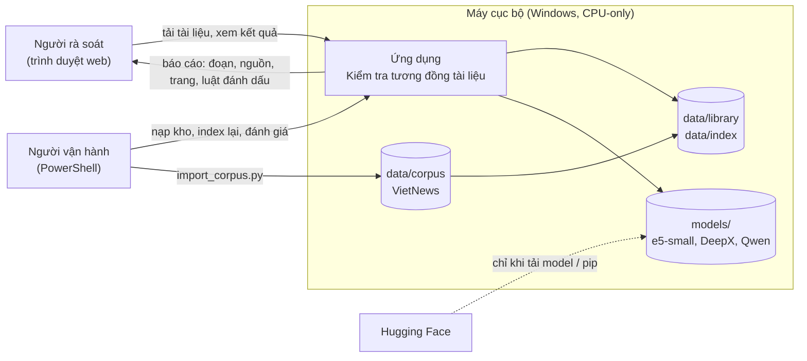
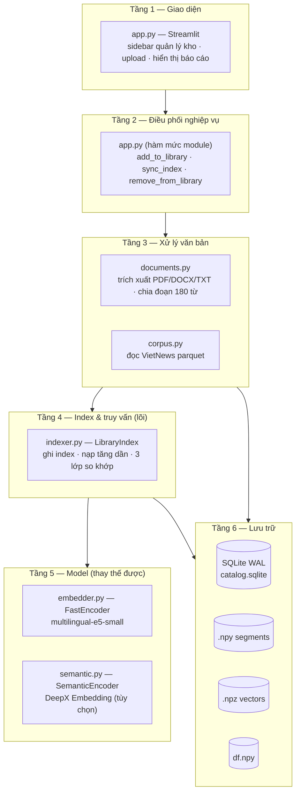
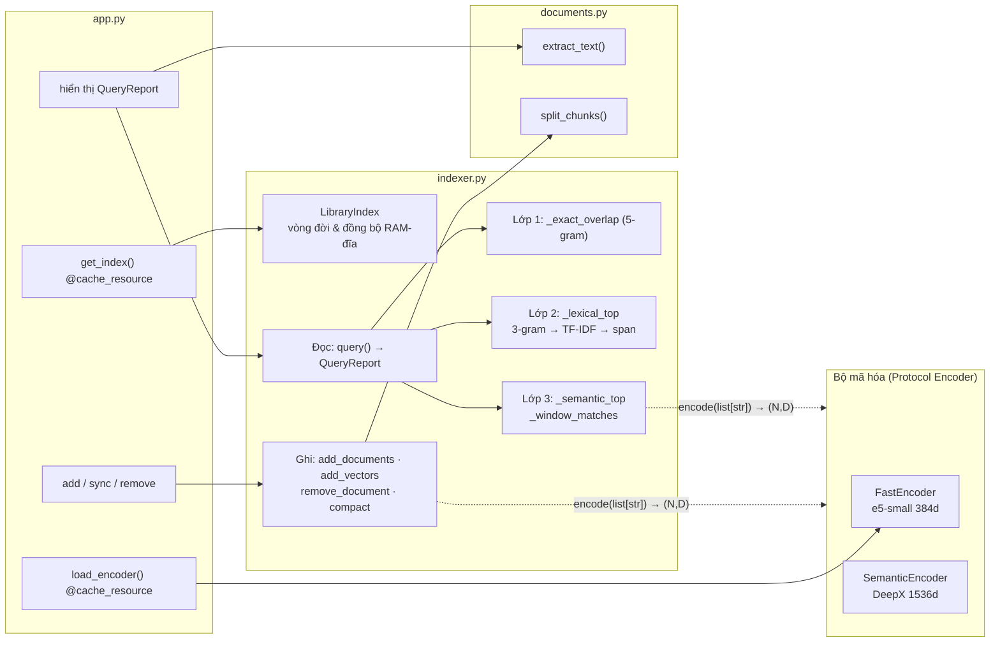
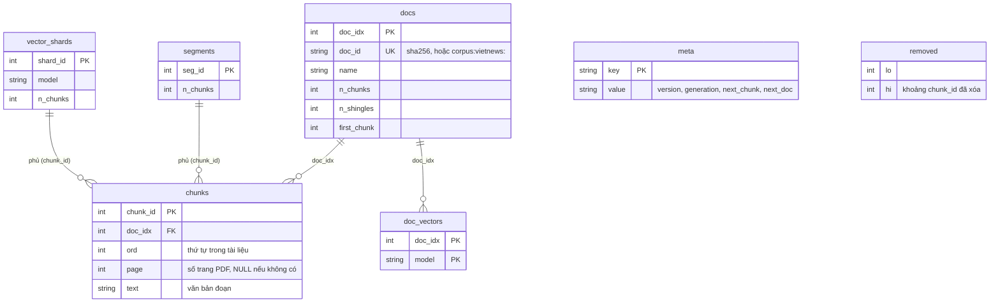
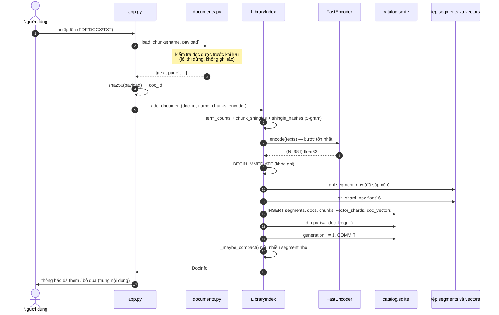
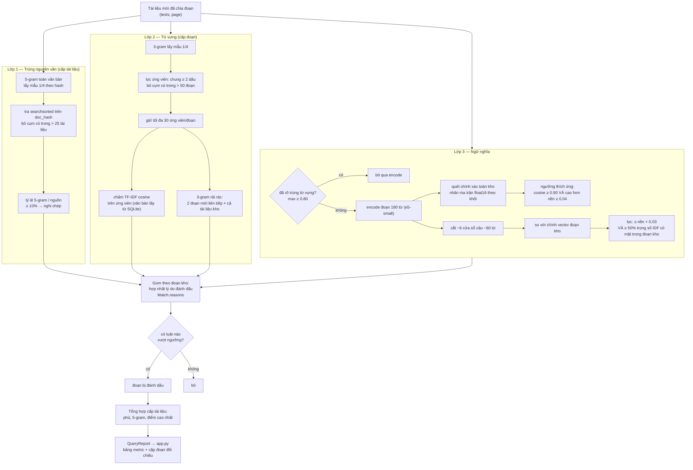
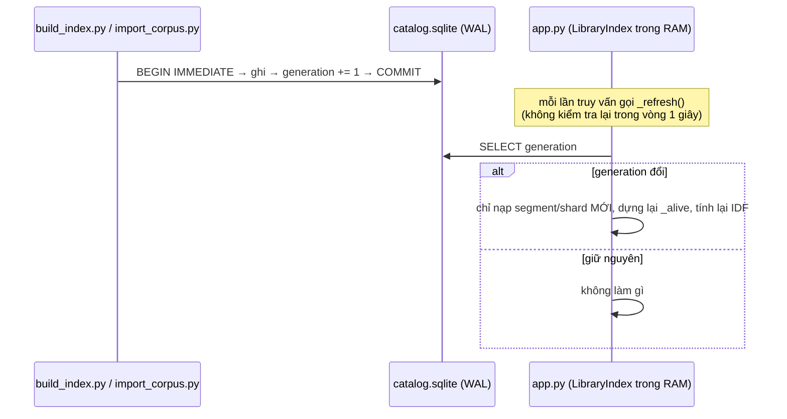
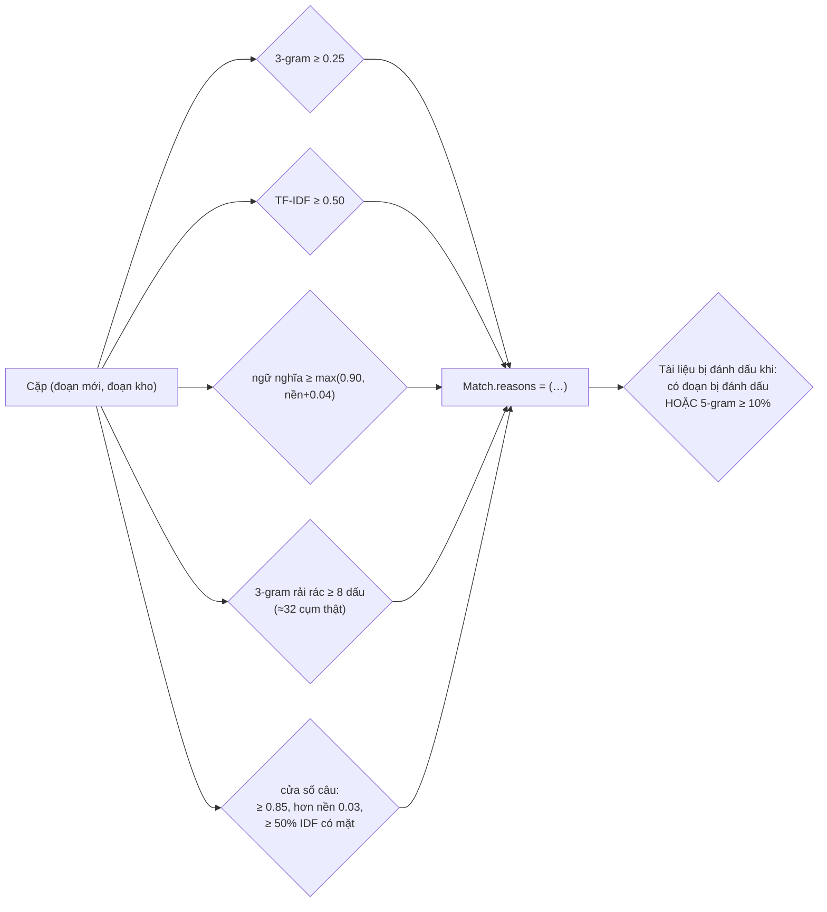
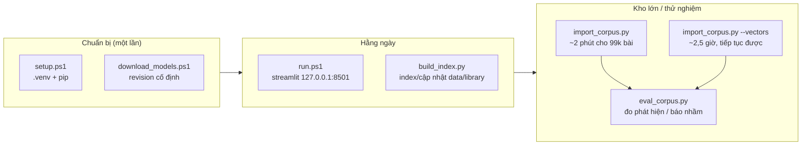

# Mô hình kiến trúc hệ thống — Kiểm tra tương đồng tài liệu

Tài liệu này mô tả kiến trúc của ứng dụng trong `AI-dao-van`: một công cụ **chạy cục bộ** đối chiếu một tài liệu mới với một kho tài liệu cũ, trả về các chỉ dấu tương đồng để con người rà soát. Nội dung phản ánh đúng mã nguồn hiện tại (phiên bản index 3).

---

## 1. Tổng quan

### 1.1 Mục tiêu

Cho một tệp PDF/DOCX/TXT mới, tìm xem nó có đoạn nào trùng với kho tài liệu nguồn đã nạp hay không, và **chỉ ra bằng chứng** để người dùng tự kết luận: đoạn nào, trùng với tài liệu nào, ở trang nào, vì lý do gì (luật nào đã đánh dấu).

### 1.2 Phạm vi

| Trong phạm vi | Ngoài phạm vi |
|---|---|
| Đối chiếu văn bản trong kho cục bộ | Kết luận đạo văn hay xác định nguồn gốc văn bản |
| Ba lớp khớp: nguyên văn, từ vựng, ngữ nghĩa | OCR cho PDF scan |
| Quản lý kho (thêm/xóa) qua giao diện web | Nhiều người dùng, phân quyền, đám mây |
| Script nạp/đánh giá kho lớn từ dòng lệnh | Sinh văn bản (Qwen3 chưa nối vào luồng) |

### 1.3 Ràng buộc thiết kế (quyết định định hình kiến trúc)

1. **Chạy hoàn toàn cục bộ** — không gọi API từ xa khi so sánh. Nội dung tài liệu không rời khỏi máy. Chỉ bước tải model và pip cần Internet, và chỉ chạy một lần.
2. **Phần cứng khiêm tốn** — Windows 11, i7-14700, RAM 16 GiB, **chỉ CPU** (không CUDA). Mọi lựa chọn model và cấu trúc index phải vừa RAM và đủ nhanh trên CPU.
3. **Kho mục tiêu ~100k tài liệu / ~365k đoạn** — con số này chi phối toàn bộ thiết kế lưu trữ và truy vấn.
4. **Server chỉ bind `127.0.0.1`** — không đưa lên mạng công cộng.
5. **Mọi phép tính nặng làm một lần lúc ghi** — lúc truy vấn chỉ xử lý tài liệu mới rồi tra index. Đây là nguyên tắc trung tâm của toàn hệ thống.

---

## 2. Kiến trúc tổng thể

### 2.1 Sơ đồ ngữ cảnh



Điểm cốt lõi: **ứng dụng là một khối cục bộ, một tiến trình, một người dùng.** Không có tầng mạng nội bộ, không có dịch vụ ngoài trong đường đi của dữ liệu.

### 2.2 Phân tầng



Nguyên tắc phụ thuộc: **đi xuống một chiều**. `indexer.py` không biết Streamlit; nó nhận danh sách `(text, page)` và một encoder theo giao thức `Encoder`. Nhờ vậy cùng lõi đó dùng được cho app, cho `build_index.py` và cho `eval_corpus.py`.

### 2.3 Sơ đồ thành phần



---

## 3. Thành phần và trách nhiệm

| Tệp | Vai trò | Trách nhiệm chính | Không làm gì |
|---|---|---|---|
| `app.py` | Giao diện Streamlit | Quản lý kho ở sidebar, tải tài liệu mới, gọi `query`, dựng bảng metric và các cặp đoạn đối chiếu | Không chứa thuật toán so khớp |
| `documents.py` | Tiền xử lý tài liệu | Trích văn bản PDF (`pypdf`), DOCX (`python-docx`), TXT (UTF-8/UTF-16/CP1258); chia cửa sổ 180 từ chồng lấn 35 từ, **giữ số trang** | Không biết gì về index |
| `indexer.py` | **Lõi hệ thống** (1187 dòng) | Định nghĩa lược đồ lưu trữ, vòng đời segment/shard, ba lớp so khớp, gom kết quả thành `QueryReport` | Không phụ thuộc Streamlit; không tự đọc tệp |
| `embedder.py` | Encoder mặc định | Nạp `multilingual-e5-small` local, mean pooling, chuẩn hóa L2, tiền tố `"query: "` cả hai phía, tối đa 512 token | Không chọn model theo ngữ cảnh |
| `semantic.py` | Encoder tùy chọn | DeepX Embedding v1 trên CPU float32, 1536 chiều: viết lại nhánh GDN-2 bằng PyTorch thuần, nạp tokenizer offline | Không dùng trong luồng mặc định (quá chậm trên CPU) |
| `corpus.py` | Nạp dữ liệu thử nghiệm | Đọc VietNews parquet, trả chữ thường (văn bản gốc đã tách từ) | Không thuộc luồng nghiệp vụ |
| `scripts/*` | Vận hành & đo lường | `setup/run/download_models` (PowerShell); `build_index`, `import_corpus`, `bench_index`, `e2e_check`, `eval_corpus` (Python) | Không chạy trong tiến trình app |
| `vendor/deepx-embed/` | Mã upstream | Cung cấp lớp kiến trúc DeepX cho `semantic.py` | Không import ở nơi khác |

### 3.1 Hợp đồng giữa các tầng

Hai giao diện hẹp giữ cho các tầng tách rời:

```python
# documents.py — đầu vào của indexer
load_chunks(name: str, payload: bytes) -> list[tuple[str, int | None]]

# indexer.py — đầu vào của tầng model (Protocol)
class Encoder(Protocol):
    name: str
    def encode(self, texts: list[str], batch_size: int = ...) -> np.ndarray: ...
    # -> (N, D) float, đã chuẩn hóa L2
```

Nhờ `Encoder` chỉ là Protocol, `indexer` dùng được e5-small, DeepX, hay bất kỳ encoder nào khác, và **app vẫn chạy được với `encoder=None`** (chế độ chỉ từ vựng). Kiểm tra `encoder.name != self.vector_model` chặn việc trộn vector của hai model khác nhau trong cùng một index.

---

## 4. Mô hình dữ liệu và lưu trữ

### 4.1 Sơ đồ thư mục

```
data/
├─ library/              tài liệu nguồn (tên tệp = sha256 nội dung)
│   ├─ <sha256>.pdf      nội dung
│   └─ <sha256>.name     tên gốc để hiển thị
├─ index/                index đang dùng (DAOVAN_INDEX_DIR đổi được)
│   ├─ catalog.sqlite    danh mục + văn bản đoạn (WAL)
│   ├─ segments/<id>/    *.npy — dấu vân tay từ vựng, bất biến
│   ├─ vectors/<model>/  <id>.npz — vector float16 theo shard
│   └─ df.npy            tần suất tài liệu cho IDF
├─ corpus/               VietNews parquet (dữ liệu thử nghiệm)
├─ index_vietnews/       index kho 100k bài
└─ eval/                 kết quả đánh giá
models/                  checkpoint cục bộ (không commit)
```

`library` dùng **sha256 của nội dung** làm khóa: tải cùng một tệp hai lần chỉ tốn một mục, và tên hiển thị tách khỏi định danh nên đổi tên không sinh bản trùng.

### 4.2 Lược đồ SQLite



Vai trò từng bảng:

- **`meta.generation`** — bộ đếm tăng mỗi lần ghi thành công. Tiến trình khác (ví dụ app đang mở) so số này để biết cần nạp lại phần nào. Đây là cơ chế cho phép script nạp kho chạy song song với app.
- **`chunks`** — chỉ chứa **văn bản**, không chứa dấu vân tay. Nhờ vậy SQLite không phình theo số 3-gram; TF-IDF được tính lại tại chỗ lúc truy vấn trên vài chục ứng viên.
- **`segments` / `vector_shards`** — con trỏ tới tệp trên đĩa. Bản thân dấu vân tay và vector không nằm trong SQLite.
- **`removed`** — đánh dấu khoảng id đã xóa thay vì sửa segment (segment là bất biến theo thiết kế).

### 4.3 Segment và shard

| | `segments/<id>/*.npy` | `vectors/<model>/<id>.npz` |
|---|---|---|
| Nội dung | `chunk_ids`, `chunk_doc`, `chunk_ord`, `fp_hash`+`fp_row` (3-gram), `doc_hash`+`doc_owner` (5-gram) | `chunk_ids`, `vectors` float16 |
| Đơn vị ghi | Một **lô tài liệu** = một segment | Một **lô ~2000 tài liệu** = một shard |
| Tính chất | Bất biến (immutable), không sửa sau khi ghi | Bất biến |
| Mục đích tách rời | Dấu vân tay tính được ngay, rẻ | Vector đắt (hàng giờ cho kho lớn) nên **encode sau, làm dần, ngắt được** |

`fp_hash` và `doc_hash` được **sắp xếp** ngay khi ghi để lúc truy vấn dùng `np.searchsorted` (tìm nhị phân) thay vì bảng băm trong RAM.

Hai cơ chế tự bảo trì:

- **Gộp segment nhỏ:** thêm từng tệp từ app sinh nhiều segment vài đoạn; `_maybe_compact` gộp các segment < 20.000 đoạn khi số lượng vượt 16. Việc gộp ghi ra thư mục tạm rồi `rename` — nguyên tử.
- **Dọn rác:** `_cleanup` xóa thư mục/tệp mồ côi (ghi bị ngắt) **cũ hơn 1 giờ**, tránh đụng vào lần ghi đang chạy của tiến trình khác.

---

## 5. Luồng nghiệp vụ

### 5.1 Ghi — thêm tài liệu vào kho



Điểm đáng chú ý: tính toán nặng (băm, encode) diễn ra **ngoài** giao dịch; giao dịch chỉ gồm thao tác ghi. Nhờ vậy khóa ghi giữ rất ngắn, và script nạp kho lớn không chặn app đang phục vụ truy vấn.

### 5.2 Đọc — kiểm tra một tài liệu mới



### 5.3 Đồng bộ nhiều tiến trình



Đây là lý do app "chỉ nạp phần mới khi kho thay đổi, không dựng lại toàn bộ" — mở app với kho 100k bài tốn 0,4–3 s, không phải đọc lại 365k đoạn.

---

## 6. Mô hình so khớp ba lớp

Ba lớp tồn tại vì **không lớp nào đủ một mình**: 5-gram bắt chép nguyên văn nhưng vô dụng khi sửa; TF-IDF bắt trùng từ vựng nhưng bỏ sót diễn đạt lại; ngữ nghĩa bắt diễn đạt lại nhưng trên kho lớn cùng thể loại thì báo nhầm gần như mọi truy vấn nếu chỉ dùng ngưỡng cố định. Kiến trúc ghép chúng **nối tiếp có chủ đích**: lớp rẻ lọc trước, lớp đắt chạy sau, và các lớp xác minh lẫn nhau.

### 6.1 Lớp 1 — Trùng nguyên văn (cấp tài liệu)

| Khía cạnh | Thiết kế |
|---|---|
| Đơn vị | Cụm 5 từ, băm thành số 64-bit |
| Tối ưu | **Lấy mẫu 1/4** theo giá trị hash (`h >> 62 == 0`) — cùng quy tắc cho kho và truy vấn nên tỷ lệ vẫn đúng, chi phí giảm 4 lần |
| Lọc văn mẫu | Cụm có mặt ở **> 25 tài liệu** ("theo thông tin từ…") bị bỏ khỏi mẫu số |
| Ngưỡng | ≥ 10% 5-gram đặc trưng của tài liệu mới có trong một nguồn |
| Tra cứu | `searchsorted` trên mảng đã sắp xếp của từng segment, không dùng bảng băm |

### 6.2 Lớp 2 — Từ vựng (cấp đoạn 180 từ)

Chạy theo thứ tự "lọc rẻ → chấm đắt":

1. **Lọc ứng viên** — 3-gram (lấy mẫu 1/4); đoạn kho phải chung ≥ 2 dấu mới được xét. Cụm có trong > 50 đoạn bị loại (phổ biến, không phân biệt được gì).
2. **Giới hạn** — tối đa 30 ứng viên/đoạn truy vấn, ưu tiên theo số dấu chung.
3. **Chấm TF-IDF cosine** — chỉ trên các cặp ứng viên; **văn bản ứng viên lấy từ SQLite và vector hóa lại lúc truy vấn**, nên không phải giữ ma trận TF-IDF toàn kho (vài GB ở 300k đoạn) trong RAM.
4. **Tỷ lệ trùng 3-gram** — chịu được sửa lẻ tẻ, không bị pha loãng khi chỉ một phần đoạn bị chép.
5. **3-gram rải rác** — đếm dấu chung giữa **2 đoạn mới liên tiếp** (~325 từ) và **cả một tài liệu kho**. Luật này bắt trường hợp chép rồi sửa nhiều và xáo câu, khi đoạn chép vắt qua ranh giới đoạn ở cả hai phía làm tỷ lệ từng-cặp-đoạn bị chia nhỏ. Điểm vẫn là đếm **cục bộ**, nên tài liệu mới dài không làm tăng điểm.

### 6.3 Lớp 3 — Ngữ nghĩa

Bộ mã hóa: `multilingual-e5-small`, 384 chiều, chạy CPU float32.

Hai tầng con:

- **Cấp đoạn** — vector đoạn kho lưu sẵn (`float16`), quét chính xác toàn kho bằng nhân ma trận PyTorch theo khối 65.536 đoạn (~20 ms cho 365k vector). Nếu không nạp được torch thì rơi về numpy, chậm hơn nhiều nhưng vẫn chạy.
- **Cấp cửa sổ câu** — đoạn mới còn được cắt thành ~6 cửa sổ ~60 từ (bắt đầu ở đầu câu, cách nhau ≥ 30 từ, câu dài cắt thành mẩu 50 từ), encode rồi so với **chính vector đoạn kho sẵn có** — không cần encode lại kho. Đây là cách "bù pha loãng" mà không tốn thêm RAM.

**Ngưỡng thích ứng** là quyết định quan trọng nhất của lớp này. Trên 365k đoạn tin tức, đoạn không liên quan gần nhất đã đạt cosine 0.93 (trung vị) đến 0.95 (p90); ngưỡng cố định 0.90 vì vậy đánh dấu nhầm gần như mọi truy vấn. Vì thế:

```
ngưỡng hiệu dụng = max(0.90,  nền + 0.04)
nền = trung bình cosine của láng giềng hạng 6–10
```

Kho nhỏ nhiều chủ đề → nền thấp → giữ sàn 0.90. Kho báo 100k bài → ngưỡng tự nâng lên ~0.95.

**Cửa sổ câu phải kèm xác minh từ vựng** vì biên so với nền chỉ 0.01–0.03, ngang tin cùng thể loại. Một cặp (cửa sổ, đoạn kho) chỉ được tính khi cosine ≥ 0.85, cao hơn nền của chính cửa sổ ≥ 0.03, **và** ≥ 50% trọng số IDF của từ/cặp từ trong cửa sổ có mặt trong đoạn kho.

### 6.4 Luật đánh dấu và ngưỡng

Một đoạn bị đánh dấu khi thỏa **một trong các luật**; mỗi luật được ghi lại nguyên văn trong `Match.reasons` để giao diện hiển thị lý do:



Nguồn (`DocResult`) trả về: **phủ** (tỷ lệ đoạn của tài liệu mới bị đánh dấu), trùng 5-gram, điểm cao nhất từng lớp, danh sách cặp đoạn kèm số trang. Ngoài các nguồn bị đánh dấu, hệ thống còn **liệt kê** nguồn chỉ tiệm cận ngưỡng để người rà soát không bỏ sót ca sát ngưỡng — điều kiện liệt kê rộng hơn điều kiện đánh dấu: có ≥ 3 dấu 5-gram mẫu chung, hoặc TF-IDF ≥ 0.20, hoặc 3-gram ≥ 0.10, hoặc ngữ nghĩa ≥ 0.85.

### 6.5 Vì sao chọn e5-small (bối cảnh quyết định)

| Phương án | Đo được | Quyết định |
|---|---|---|
| `multilingual-e5-small` | ~41 đoạn/s, 384 chiều, nạp ~1 s, encode kho 100k bài hết 148 phút | **Mặc định** |
| DeepX Embedding v1 | ~2.8–6.3 s/đoạn, 1536 chiều, 3.5 GB RAM | Tùy chọn, không dùng mặc định (encode 365k đoạn mất ~12 ngày) |
| Vector câu phía kho | Thêm ~5 giờ encode và ~1.65 GB RAM; nâng biên ca "sửa nặng" 0.034 → 0.060 nhưng ca "tóm tắt" gần như không đổi | **Đã ước lượng, chưa làm** — hai luật thay thế đã đưa "sửa nặng" lên 72–80% mà không tốn RAM |
| Lượng tử hóa int8 cho e5-small | Nhanh hơn 1.3× nhưng vector lệch (cosine 0.96–0.97 so với float32) | Không dùng — đủ để làm sai ngưỡng |

---

## 7. Thuộc tính chất lượng

### 7.1 Hiệu năng (i7-14700, CPU, kho 99.134 bài / 365.140 đoạn)

| Hạng mục | Kết quả |
|---|---|
| Mở index khi khởi động app | 0,4–3 s; RAM 308 MB (từ vựng) + 267 MB (vector float16) |
| Truy vấn chỉ từ vựng (~2,7 đoạn) | p50 8 ms · p95 14 ms |
| Truy vấn có ngữ nghĩa (~2,7 đoạn) | p50 240 ms · p95 303 ms |
| Trong đó: encode | 148 ms (đoạn + ~6 cửa sổ/đoạn) |
| Trong đó: quét 365k vector | 21 ms |
| Trong đó: cửa sổ câu (quét + xác minh) | 56 ms |
| Đĩa | SQLite 410 MB + segment 301 MB + vector 271 MB |

**Thời gian truy vấn gần như không tăng theo kích thước kho.** Bốn quyết định giữ tính chất này:

1. Chỉ tra ứng viên qua index ngược (tìm nhị phân trên mảng hash đã sắp xếp).
2. Bỏ cụm từ quá phổ biến ở cả ba lớp.
3. Chấm TF-IDF chỉ trên tối đa 30 ứng viên mỗi đoạn.
4. Nhân ma trận float16 bằng PyTorch (numpy phải đổi sang float32, mất ~0,7 s/truy vấn ở 365k vector).

Phần tốn nhất còn lại là **encode tài liệu mới** (~55 ms/đoạn tính cả cửa sổ câu). Đoạn và cửa sổ được encode thành hai lượt riêng vì chung một batch thì cửa sổ ngắn bị đệm tới độ dài đoạn và chậm hơn ~35%.

### 7.2 Khả mở rộng

- Thêm tài liệu = thêm segment bất biến; không ghi lại gì cũ.
- Encode kho lớn chạy theo shard, **ngắt được và chạy lại để tiếp tục**.
- Gộp segment nhỏ tự động khi số lượng tăng.
- Có tầng thô/tinh cho model Matryoshka (`coarse_dim`) nếu sau này dùng model lớn trên máy có GPU.

### 7.3 Độ tin cậy

| Tình huống | Ứng dụng làm gì |
|---|---|
| Không nạp được model ngữ nghĩa (thiếu file, DLL bị chặn) | **Chạy tiếp chế độ từ vựng**: cảnh báo, cột Ngữ nghĩa để trống, 5-gram/TF-IDF vẫn hoạt động. Có nút "Thử nạp lại model"; tài liệu thiếu vector được bổ sung sau |
| Ghi index bị ngắt giữa chừng | Thư mục/tệp tạm bị bỏ lại, dọn tự động sau 1 giờ (`_cleanup`), không đụng lần ghi đang chạy |
| Tiến trình khác vừa gộp segment | Bắt `FileNotFoundError` và nạp lại từ đầu theo danh sách mới |
| Index sai phiên bản | `INDEX_VERSION` không khớp → báo lỗi rõ ràng yêu cầu xóa và index lại, thay vì đọc sai âm thầm |
| Windows chặn DLL scipy/torch | Ghi nhận trong README; chạy lại thường hết; **không tắt chính sách bảo mật** |

### 7.4 Riêng tư và an ninh

- Nội dung tài liệu **không gửi tới API đám mây** — toàn bộ suy luận chạy cục bộ.
- Server bind `127.0.0.1`, `headless`, tắt thu thập số liệu sử dụng (`gatherUsageStats = false`).
- Model tải tại revision cố định, **không chạy mã từ Hugging Face**; `HF_HUB_OFFLINE`/`TRANSFORMERS_OFFLINE` bật trong `run.ps1`.
- Trọng số model, tài liệu cá nhân và môi trường Python đều bị `.gitignore` loại trừ.
- Giới hạn 25 MB/tệp; chỉ nhận `.pdf`, `.docx`, `.txt`.

### 7.5 Khả kiểm thử và đo lường

Hệ thống có bộ đánh giá riêng vì ngưỡng chỉ có nghĩa khi đo trên dữ liệu thật:

- `scripts/eval_corpus.py` — dựng 6 kiểu truy vấn (chép nguyên văn, sửa nhẹ, sửa nặng + xáo câu, hai nguồn, tóm tắt, âm tính) từ VietNews, biết trước nguồn nên đo được tỷ lệ phát hiện, top-1 và báo nhầm.
- `scripts/bench_index.py` — kho giả lập, không cần model.
- `scripts/e2e_check.py` — văn bản tiếng Việt thật + e5-small.

**Kết quả then chốt** (seed 23, dữ liệu chưa thấy khi chỉnh ngưỡng): ca "sửa nặng + xáo câu" từ 35% lên **72%** phát hiện, báo nhầm âm tính 0%. Điều này cũng là mô hình "chỉnh ngưỡng trên một seed, báo cáo trên seed khác" — tránh overfit.

---

## 8. Triển khai và vận hành



Hai chế độ index, chuyển bằng biến môi trường:

| Biến | Ý nghĩa |
|---|---|
| `DAOVAN_INDEX_DIR` | Trỏ app sang index khác (ví dụ `data/index_vietnews`) |
| `HF_HUB_OFFLINE` / `TRANSFORMERS_OFFLINE` | Bắt buộc offline (đặt trong `run.ps1`) |

Vận hành hằng ngày: mở app → tệp có trong `data/library` nhưng chưa có trong index **tự được index khi mở app** (`sync_index`); tài liệu đã xóa khỏi `data/library` tự bị gỡ khỏi index. Tài liệu nạp bằng script có tiền tố `corpus:` nên **không bị app tự gỡ**.

---

## 9. Rủi ro đã biết và hướng mở rộng

| Hạn chế | Nguyên nhân | Hướng xử lý |
|---|---|---|
| Tóm tắt/sapo viết lại sâu vẫn chưa bắt được (2–5%) | Sapo chỉ chung 13–40% trọng số từ đặc trưng; cosine e5-small ~0.89–0.91 trong khi nền ~0.88–0.90 — giống hệt một tin cùng thể loại | Cần model embedding mạnh hơn, hoặc **cross-encoder/NLI** chấm lại top ứng viên (chưa làm) |
| Phía kho chỉ có vector đoạn 180 từ | Cửa sổ câu phía truy vấn bù được một phần, không bù được bản viết lại sâu | Vector câu phía kho (đã ước lượng: ~5 giờ, ~1,65 GB RAM) — chưa làm vì máy thường thiếu RAM |
| PDF scan không có lớp text | Chưa tích hợp OCR | Báo lỗi rõ ràng, yêu cầu OCR trước |
| Bộ thử chỉ sửa từ ngẫu nhiên, không có văn bản do mô hình ngôn ngữ viết lại | Máy không đủ RAM chạy Qwen sinh văn bản cùng lúc | Coi tỷ lệ "sửa nặng" là ước lượng thô cho đạo văn diễn đạt lại |
| Độ nhạy còn giới hạn bởi kích thước đoạn | `CHUNK_WORDS = 180` | Giảm giá trị rồi `build_index.py --rebuild` — đổi lại kho lớn hơn, encode lâu hơn |
| Qwen3-1.7B chưa nối vào luồng | Là model sinh văn bản, không phải model embedding/detector | Nối vào như tầng giải thích, không phải tầng phán quyết |

**Ranh giới đạo đức được mã hóa trong thiết kế:** kết quả là *chỉ dấu để rà soát*, không phải kết luận. Giao diện ghi rõ điều này ở tiêu đề, và mọi cặp đoạn đều kèm lý do (`reasons`) cùng cửa sổ khớp để người rà soát tự đánh giá — hệ thống được thiết kế để **con người quyết định**, không để thay con người quyết định.

---

## 10. Bản đồ mã nguồn

| Muốn thay đổi | Sửa ở đâu |
|---|---|
| Ngưỡng đánh dấu | Hằng số đầu `indexer.py` (`LEXICAL_FLAG`, `OVERLAP_FLAG`, `EXACT_FLAG`, `SEMANTIC_FLAG`, `SEMANTIC_MARGIN`, `SPAN_SHARED_FLAG`, `WINDOW_*`) |
| Kích thước đoạn | `documents.CHUNK_WORDS`, `CHUNK_OVERLAP` (cần `--rebuild`) |
| Cửa sổ câu | `indexer.WINDOW_WORDS`, `WINDOW_STRIDE`, `WINDOW_PIECE`, `WINDOW_MIN_WORDS` |
| Số ứng viên / giới hạn quét | `MIN_SHARED`, `LEX_CANDIDATES`, `COARSE_CANDIDATES`, `SCAN_BLOCK`, `DOC_FP_CAP`, `CHUNK_FP_CAP` |
| Đổi model ngữ nghĩa | `indexer.DEFAULT_VECTOR_MODEL` + `embedder.py` / `semantic.py` |
| Giao diện hiển thị | `app.py` (bảng metric, expander cặp đoạn) |
| Định dạng nhận vào | `documents.py` (`ALLOWED_SUFFIXES`, `MAX_UPLOAD_BYTES`, `extract_text`) |
| Lược đồ lưu trữ | `indexer._SCHEMA` + `INDEX_VERSION` (phải tăng version khi đổi lược đồ) |

Đọc theo thứ tự để hiểu hệ thống: `README.md` (hành vi) → `documents.py` (đầu vào) → `embedder.py` (model) → `indexer.py` (`_query`, `_lexical_top`, `_semantic_top`) → `app.py` (trình bày).